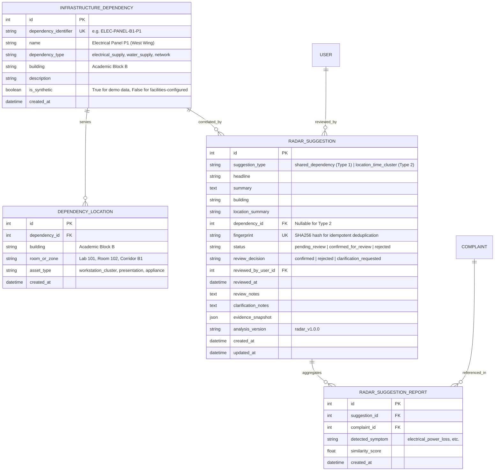

# Campus Incident Radar (Operational Correlation Advisory)

## 1. Executive Summary & Purpose

### Fundamental Difference: Duplicate Detection vs. Incident Radar

| Dimension | Duplicate Grouping (`Issue` & `IssueReport`) | Incident Radar (`RadarSuggestion` & `RadarSuggestionReport`) |
| :--- | :--- | :--- |
| **Core Question** | *"Are these reports about the **same incident**?"* | *"Could different reports be symptoms of a **shared operational incident**?"* |
| **Typical Example** | 3 students all report: "Water cooler leaking in Academic Block B Hallway". | Report 1: "Computers suddenly lost power in Lab 101."<br>Report 2: "Projector has no electrical power in Room 102."<br>Report 3: "Water dispenser cooler power cut in Hallway B1." |
| **Operational Hypothesis** | Multiple witnesses reporting the exact same broken asset or event. | Different assets/symptoms failing simultaneously due to a shared physical dependency (e.g. Electrical Panel `ELEC-PANEL-B1-P1`). |
| **Automated Action** | Consolidates identical reports into a single master ticket to prevent redundant crew dispatch. | **None.** Advisory suggestion only. Does **NOT** auto-merge tickets, alter complaint statuses, resolve issues, or assign blame. |
| **Human Role** | Dispatcher verifies duplicate clustering and tracks aggregate headcount. | Facilities Manager conducts cross-department operational inspection (e.g., dispatching an electrician to verify feeder breakers before sending separate IT/appliance technicians). |

### Non-Goals & Safety Guardrails
- **Not Root-Cause Proof**: Does not claim a failed breaker/valve has been definitively proven. Physical sensor telemetry is missing; on-site inspection is required.
- **Not Predictive Maintenance**: Does not predict future failures.
- **Not Automated Escalation**: Does not automatically mark tickets as P1 or auto-resolve tickets.
- **Strict Privacy**: Submitter identities (names, emails, student IDs) are strictly omitted from Radar APIs and review interfaces.
- **Tamper-Evident Review**: Retains human confirmation, rejection, and clarification decisions across repeated scans with immutable audit trail events.

---

## 2. Architecture & Data Schema

### Relational Schema (SQLAlchemy Models in `app/models/radar.py`)



---

## 3. Correlation Pipeline (`app/services/incident_radar.py`)

### A. Candidate Selection
1. **Configurable Lookback Boundary**: Defaults to `RADAR_LOOKBACK_HOURS = 48` hours. Historical resolved complaints outside this window are strictly excluded.
2. **Correlation Time Window**: Defaults to `RADAR_CORRELATION_WINDOW_HOURS = 4` hours. Disconnected reports days apart cannot be correlated into a shared incident.
3. **Candidate Hard Limit**: Bounded at `RADAR_MAX_CANDIDATES = 60` complaints per run to avoid unconstrained compute or memory exhaustion.
4. **Time Basis**: Uses `created_at` (submission timestamp) and explicitly labels this limitation in the evidence snapshot: `"time_basis": "submission_time"`.

### B. Symptom Extraction & Fallback Architecture
- **Versioned Symptom Prototypes (`symptom_prototypes_v1`)**:
  - `electrical_power_loss`: power cut, outage, tripped breaker, screens went dark, no electrical power, short circuit.
  - `water_supply_disruption`: water stopped, low pressure, pipe burst, dry tap, dispenser empty.
  - `network_outage`: wifi down, ethernet disconnected, no internet, switch offline.
- **Neural Semantic vs. Rule Fallback**:
  - When embedding weights are available (`all-MiniLM-L6-v2`), cosine similarity against prototype anchors classifies symptom types.
  - If model weights are missing or running in test/restricted environments (`is_semantic_available == False`), the pipeline safely degrades to deterministic keyword prototype matching.
  - The analysis method is recorded honestly in the evidence: `"analysis_method": "rule_based_symptom_v1"` or `"neural_embedding_v1"`. It never fabricates neural confidence scores.

### C. Infrastructure Dependency Validation
- Checks configured relational mappings (`InfrastructureDependency` & `DependencyLocation`).
- **Compatibility Matrix (`DEPENDENCY_SYMPTOM_COMPATIBILITY`)**:
  - `electrical_supply` ONLY connects to `electrical_power_loss`.
  - `water_supply` ONLY connects to `water_supply_disruption`.
  - `network` ONLY connects to `network_outage`.
- If a complaint in Academic Block B reports a foul odor or broken chair, it is **never** linked to an electrical panel simply because that room has lights.

### D. Output Types
- **Type 1: Possible Shared-Dependency Incident (`shared_dependency`)**:
  - Requires: $\ge 2$ eligible reports, temporal overlap ($\le 4\text{ hours}$), shared physical infrastructure dependency link, and compatible symptoms.
  - Headline: *"Possible shared-dependency incident in {building}: {dependency_name}"*
- **Type 2: Location/Time Cluster (`location_time_cluster`)**:
  - Requires: $\ge 2$ eligible reports in the same building within the correlation window, but **without** any established infrastructure dependency link.
  - Headline: *"Location/Time Cluster: {building}"*
  - Mandatory wording: *"Multiple disruptions reported in this area. Cause unknown."*

### E. Idempotency & Review Retention
- Computes SHA-256 fingerprint: `sha256(type:building:dependency_id:sorted_complaint_ids)`.
- If a suggestion was already reviewed by a facilities handler (`confirmed_for_review` or `rejected`), re-running the radar scan **preserves** the decision and does not recreate or overwrite it.

---

## 4. REST API Endpoints (`app/blueprints/api/admin.py`)

All endpoints require handler or admin credentials (`@handler_required`). Student access returns HTTP 403. Unauthenticated access returns HTTP 401.

| Method | Endpoint | Description | Privacy & Safety |
| :--- | :--- | :--- | :--- |
| `GET` | `/api/admin/radar` | Lists active suggestions with filter (`status`, `suggestion_type`, `building`). | Omits submitter names, emails, and student IDs. |
| `GET` | `/api/admin/radar/<id>` | Full evidence snapshot, reasons, missing info, and linked reports. | Strictly anonymous report metadata (`id`, `title`, `room`, `category`). |
| `POST` | `/api/admin/radar/refresh` | Executes bounded correlation analysis on active complaints. | CSRF-protected, bounded runtime. |
| `POST` | `/api/admin/radar/<id>/review` | Submits human review (`confirm`, `reject`, `clarify`). | Logs immutable `AuditEvent`. Does not auto-merge tickets. |
| `GET` | `/api/admin/radar/dependencies` | Returns configured infrastructure dependencies. | Read-only inventory. |
| `POST` | `/api/admin/radar/seed-demo` | Seeds synthetic Scenario A (Block B electrical panel P1). | Explicitly marked as `is_synthetic: true`. |

---

## 5. Evaluation & Test Scenarios

The suite in `tests/test_incident_radar.py` validates the required test cases:

```
tests/test_incident_radar.py::test_extract_report_symptom_and_fallbacks PASSED
tests/test_incident_radar.py::test_seed_synthetic_radar_demo_idempotency PASSED
tests/test_incident_radar.py::test_scenario_a_supported_shared_connection PASSED
tests/test_incident_radar.py::test_scenario_b_unrelated_reports_no_incident_assertion PASSED
tests/test_incident_radar.py::test_scenario_c_location_time_cluster_without_dependency PASSED
tests/test_incident_radar.py::test_scenario_d_incompatible_symptoms_not_linked PASSED
tests/test_incident_radar.py::test_radar_review_lifecycle_and_audit PASSED
tests/test_incident_radar.py::test_radar_api_privacy_omits_submitter_pii PASSED
tests/test_incident_radar.py::test_radar_unauthorized_access_blocked PASSED
```

- **Scenario A (Supported Connection)**: 3 distinct complaints in Academic Block B (workstation power cut, projector power failure, water cooler off) sharing `ELEC-PANEL-B1-P1` correctly generate Type 1 suggestion.
- **Scenario B (Unrelated Reports)**: Similar power outage wording across different buildings (Academic Block A vs Central Library) 3 days apart generates **zero** shared incident suggestions.
- **Scenario C (Location/Time Cluster)**: Broken door lock and chair in Boys Hostel 1 with no shared dependency generate Type 2 suggestion with explicit *"Multiple disruptions reported in this area. Cause unknown."* summary.
- **Scenario D (Incompatible Symptoms)**: Power outage in Lab 101 and foul odor in Washroom 102 are not linked to `ELEC-PANEL-B1-P1`.
- **Privacy Verification**: Direct string assertion confirms submitter email and full name do not appear anywhere in radar JSON payloads.
- **Review Lifecycle**: Retains review decisions across re-scans without mutating source complaints.

---

## 6. Runtime & CLI Operations

### Run CLI Commands
```powershell
# 1. Seed synthetic demo dependency and scenario complaints
.\.venv\Scripts\python.exe -m flask radar-seed-demo

# 2. Run radar correlation scan via CLI
.\.venv\Scripts\python.exe -m flask radar-scan

# 3. Run complete test suite (47 tests)
.\.venv\Scripts\python.exe -m pytest tests/
```

### Frontend UI Access
1. Open Admin Dashboard at `http://localhost:5000/admin`.
2. Locate the **Campus Incident Radar** section above Multi-Report issues.
3. Click **Seed Demo Scenario** to populate the Academic Block B electrical panel scenario.
4. Click **Inspect Evidence** on the generated suggestion card to inspect the evidence snapshot, symptom classifications, missing operational information, and submit review decisions (`Confirm for Coordinated Review`, `Reject Connection`, `Save Clarification Note`).

