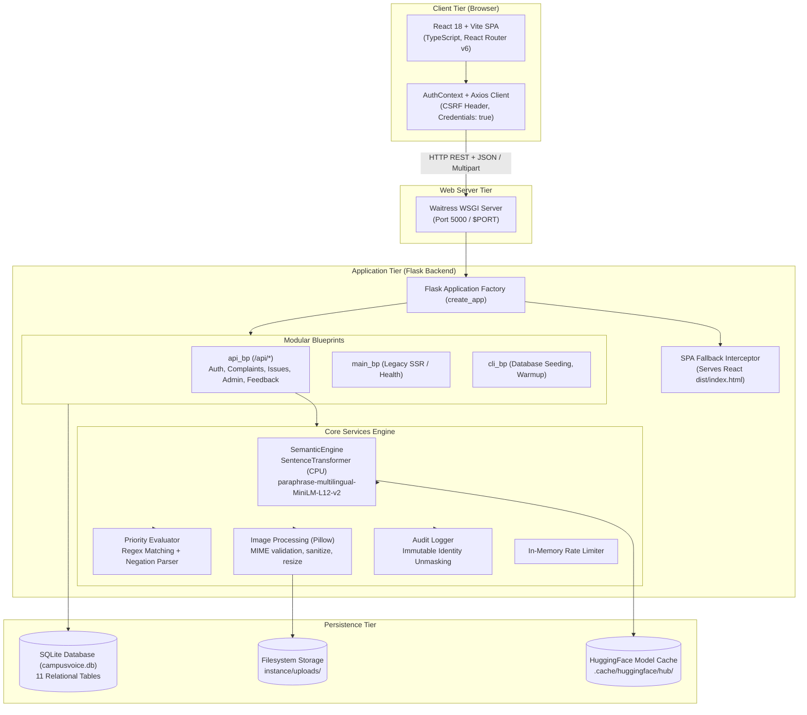
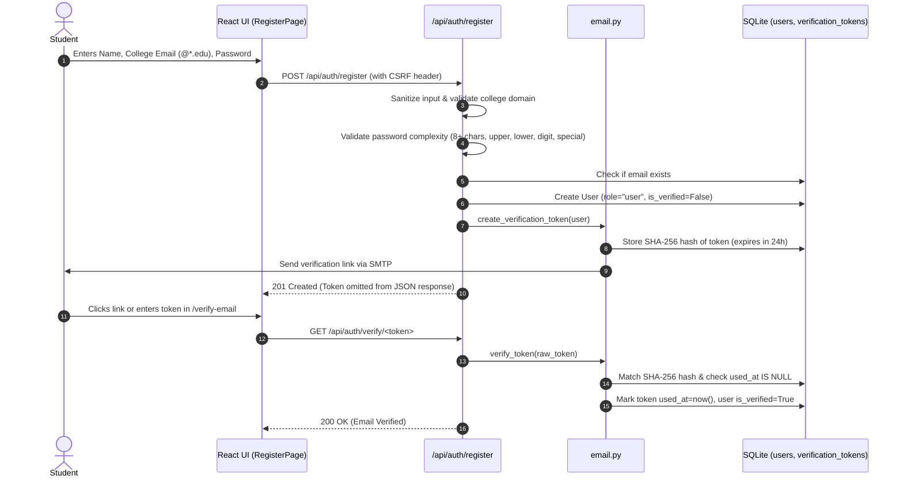
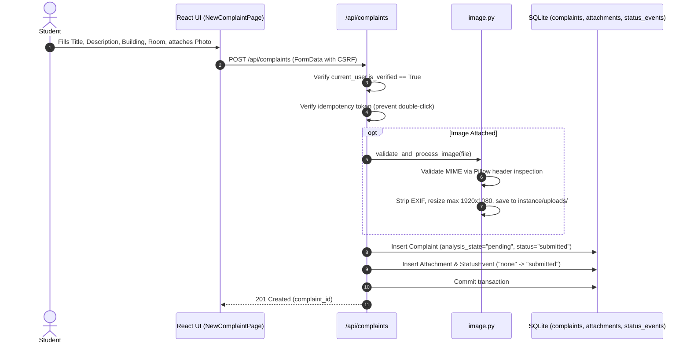
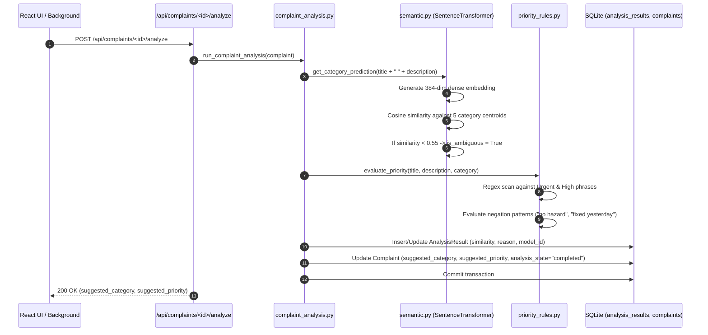
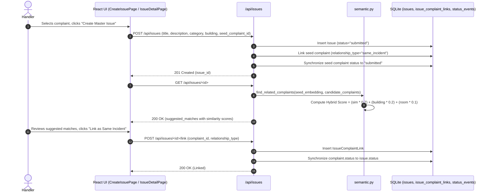
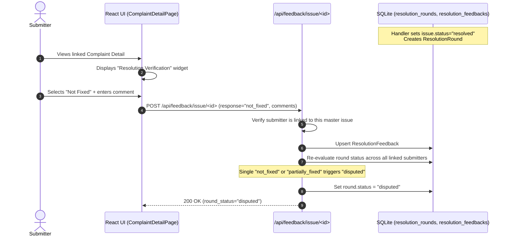

# CampusVoice: Project Overview & Architecture Guide

## 1. Executive Summary & Core Purpose

**CampusVoice** is a centralized campus complaint and resolution tracking platform designed to eliminate scattered feedback channels (WhatsApp groups, emails, informal complaints) in universities and colleges.

The platform provides:
- **Verified Submissions**: Only authenticated students, faculty, and staff with valid institutional college email addresses (`@*.edu`) can submit complaints or suggestions.
- **Intelligent Semantic Triage**: An embedded multilingual sentence transformer (`paraphrase-multilingual-MiniLM-L12-v2`) classifies unstructured complaints into operational campus categories and flags low-confidence predictions (`similarity < 0.55`) as *ambiguous* for human review.
- **Rule-Based Safety Prioritization**: Deterministic keyword and negation-aware rules detect urgent life-safety issues (e.g., exposed wires, gas leaks, structural collapse) while ignoring historical or negated context (e.g., "no fire hazard").
- **Duplicate & Related Issue Grouping**: Hybrid semantic cosine similarity and spatial proximity scoring suggest related complaints to campus handlers, enabling master issue creation without losing individual submitter records.
- **Submitter Privacy & Audited Identity Reveal**: Handler queues display submissions anonymously (`Anonymous Submitter #42`). Submitter identity can only be unmasked by an identity-authorized administrator providing a mandatory, non-empty operational reason, which is permanently recorded in an immutable audit ledger.
- **Closed-Loop Resolution Feedback (Innovation)**: When an issue is marked resolved, it is not permanently closed until the original submitters verify whether the problem was actually fixed (`fixed`, `partially_fixed`, `not_fixed`). A single unresolved vote automatically shifts the resolution round into a `disputed` state.

---

## 2. Architecture & Technology Stack



### Component Details
| Component | Technology | Version | Purpose |
| :--- | :--- | :--- | :--- |
| **Frontend Framework** | React + TypeScript | 18.3.1 / 5.4.5 | Single Page Application with interactive state management |
| **Build Tool** | Vite | 5.4.21 | Module bundler producing production bundle in `frontend/dist` |
| **Routing** | React Router DOM | 6.23.1 | Declarative client-side routing with role-based guards |
| **Styling** | Bootstrap + Custom CSS | 5.3.3 | Responsive mobile-first design with bottom navigation |
| **Charts & Metrics** | Recharts | 2.12.7 | Interactive categorical and status breakdown visualizations |
| **Backend Framework** | Flask | 3.1.3 | WSGI web application framework and REST API host |
| **ORM & Database** | Flask-SQLAlchemy / SQLite | 3.1.1 / 2.1.6 | Relational persistence with 11 relational schemas |
| **Authentication** | Flask-Login | 0.6.3 | Session-based user management with secure cookies |
| **CSRF Defense** | Flask-WTF | 1.3.0 | Cryptographic session-bound CSRF token validation |
| **WSGI Server** | Waitress | 3.0.2 | Production-ready multi-threaded Windows/Linux WSGI server |
| **AI / NLP Model** | `sentence-transformers` | 6.2.0 | Dense semantic vector embeddings (`dim=384`) |
| **Deep Learning** | PyTorch (CPU) | 2.15.0 | Torch tensor operations for cosine similarity calculation |
| **Image Handling** | Pillow (PIL) | 13.0.0 | Image verification, sanitization, stripping EXIF, resizing |

---

## 3. Repository Directory Structure

```
Digital_campus/
│
├── app/                              # Flask application package
│   ├── blueprints/                   # Architectural modular routes
│   │   ├── admin/                    # Legacy server-rendered admin views
│   │   ├── api/                      # REST API endpoints (Active JSON tier)
│   │   │   ├── __init__.py           # Blueprint initialization (/api prefix)
│   │   │   ├── admin.py              # Queue, dashboard metrics, reveal-identity, audit log
│   │   │   ├── auth.py               # CSRF token, login, register, verify, logout, me
│   │   │   ├── complaints.py         # Submissions, analysis trigger, details, attachment serve
│   │   │   ├── feedback.py           # Resolution feedback submission & round re-evaluation
│   │   │   └── issues.py             # Public issue list, handler master issue, link/unlink, status
│   │   ├── auth/                     # Legacy server-rendered auth forms
│   │   ├── complaints/               # Legacy server-rendered complaint templates
│   │   ├── feedback/                 # Legacy feedback route handlers
│   │   ├── issues/                   # Legacy issue management views
│   │   └── main/                     # SPA root and static asset fallback routes
│   │
│   ├── models/                       # SQLAlchemy Database Schemas
│   │   ├── audit.py                  # AuditEvent (immutable admin access log)
│   │   ├── complaint.py              # Complaint, Attachment, AnalysisResult
│   │   ├── feedback.py               # ResolutionRound, ResolutionFeedback
│   │   ├── issue.py                  # Issue, IssueComplaintLink, StatusEvent
│   │   └── user.py                   # User, VerificationToken
│   │
│   ├── services/                     # Business Logic & Core Algorithms
│   │   ├── audit.py                  # Audited identity reveal business logic
│   │   ├── complaint_analysis.py     # Pipeline coordinating NLP & rule engines
│   │   ├── email.py                  # Email dispatch, token hashing, expiration
│   │   ├── fixtures.py               # Synthetic demo seed data generator
│   │   ├── image.py                  # Pillow image processing and sanitization
│   │   ├── priority_rules.py         # Regex keyword matching with negation handling
│   │   ├── rate_limiter.py           # Sliding window IP/user rate limiter
│   │   ├── security.py               # Sanitization, password complexity, decorators
│   │   └── semantic.py               # SentenceTransformer loading & cosine similarity
│   │
│   ├── static/                       # Legacy server-side CSS/JS assets
│   ├── templates/                    # Legacy Jinja2 HTML templates
│   ├── cli.py                        # Click CLI commands (seed-demo, warmup-model, reset-db)
│   ├── config.py                     # Configuration classes (Development, Production, Testing)
│   ├── extensions.py                 # Initialized extensions (db, login_manager, csrf)
│   ├── forms.py                      # WTForms form validations (legacy)
│   └── __init__.py                   # Application factory (create_app) & SPA fallback
│
├── frontend/                         # Modern React 18 Single Page Application
│   ├── dist/                         # Compiled production bundle served by Flask
│   │   ├── assets/                   # JS and CSS bundles
│   │   └── index.html                # SPA entrypoint
│   ├── src/                          # TypeScript React source
│   │   ├── api/
│   │   │   └── client.ts             # Axios instance with CSRF handling & credentials
│   │   ├── components/
│   │   │   ├── BottomNav.tsx         # Mobile bottom navigation bar (Home, Tracker, Settings)
│   │   │   ├── Navbar.tsx            # Desktop header with user badge & logout
│   │   │   └── StatusBadge.tsx       # Reusable status/priority badge UI
│   │   ├── context/
│   │   │   └── AuthContext.tsx       # Global auth state & session bootstrap
│   │   ├── pages/                    # 13 Screen views (Dashboard, Queue, Detail, etc.)
│   │   ├── App.tsx                   # Route definitions & ProtectedRoute wrappers
│   │   └── main.tsx                  # Root DOM mounting
│   ├── package.json                  # NPM dependencies & build scripts
│   └── vite.config.ts                # Vite configuration
│
├── tests/                            # Pytest Automated Test Suite
│   ├── conftest.py                   # Test fixtures (in-memory SQLite, test clients)
│   ├── test_auth.py                  # Auth, registration, token verification tests
│   ├── test_complaints.py            # Complaint submission, attachments, idempotency
│   ├── test_feedback.py              # Resolution feedback rounds & state transitions
│   ├── test_issues.py                # Issue linking, status updates, event logs
│   └── test_semantic_and_rules.py    # AI embeddings, category centroids, priority rules
│
├── instance/
│   └── uploads/                      # Uploaded complaint attachments
├── docs/                             # Documentation & Audit Reports
│   └── audit/                        # Comprehensive audit findings and matrices
├── requirements.txt                  # Python dependencies
├── run.py                            # Production entrypoint running Waitress server
└── render.yaml                       # Render cloud deployment blueprint
```

---

## 4. The 9 End-to-End User Journeys

### Journey 1: Student Registration & Email Verification

- **Frontend Components**: [`RegisterPage.tsx`](file:///c:/Users/Rohit/Digital_campus/Digital_campus/frontend/src/pages/RegisterPage.tsx), [`VerifyEmailPage.tsx`](file:///c:/Users/Rohit/Digital_campus/Digital_campus/frontend/src/pages/VerifyEmailPage.tsx).
- **Backend Endpoints**: `POST /api/auth/register`, `GET /api/auth/verify/<token>`, `POST /api/auth/resend-verification`.
- **Controllers & Services**: `app.blueprints.api.auth.register`, `app.services.email.create_verification_token`, `app.services.email.verify_token`.
- **Database Models**: [`User`](file:///c:/Users/Rohit/Digital_campus/Digital_campus/app/models/user.py#L9), [`VerificationToken`](file:///c:/Users/Rohit/Digital_campus/Digital_campus/app/models/user.py#L76).
- **Permissions**: Public unauthenticated access, rate-limited (10 req/min).
- **Error Handling**: Non-college domain rejected (400), weak password rejected (400), token expired or reused rejected (400), cooldown limit on resend (429).

---

### Journey 2: Submitting a Complaint with Optional Photo

- **Frontend Components**: [`NewComplaintPage.tsx`](file:///c:/Users/Rohit/Digital_campus/Digital_campus/frontend/src/pages/NewComplaintPage.tsx).
- **Backend Endpoints**: `POST /api/complaints`.
- **Controllers & Services**: `app.blueprints.api.complaints.create_complaint`, `app.services.image.validate_and_process_image`.
- **Database Models**: [`Complaint`](file:///c:/Users/Rohit/Digital_campus/Digital_campus/app/models/complaint.py#L8), [`Attachment`](file:///c:/Users/Rohit/Digital_campus/Digital_campus/app/models/complaint.py#L110), [`StatusEvent`](file:///c:/Users/Rohit/Digital_campus/Digital_campus/app/models/issue.py#L104).
- **Permissions**: `login_required`, `verified_user_required`.
- **Error Handling**: Unverified users blocked (403), duplicate submission detected via idempotency key (returns existing record 200 or 409 conflict), corrupt or oversized image rejected (400).

---

### Journey 3: AI Semantic Classification & Priority Detection

- **Frontend Components**: Invoked immediately after creation in [`NewComplaintPage.tsx`](file:///c:/Users/Rohit/Digital_campus/Digital_campus/frontend/src/pages/NewComplaintPage.tsx#L85), retry button in [`ComplaintDetailPage.tsx`](file:///c:/Users/Rohit/Digital_campus/Digital_campus/frontend/src/pages/ComplaintDetailPage.tsx).
- **Backend Endpoints**: `POST /api/complaints/<id>/analyze`, `POST /api/complaints/<id>/retry-analysis`.
- **Controllers & Services**: `app.services.complaint_analysis.run_complaint_analysis`, `app.services.semantic.SemanticEngine`, `app.services.priority_rules.evaluate_priority`.
- **Database Models**: [`AnalysisResult`](file:///c:/Users/Rohit/Digital_campus/Digital_campus/app/models/complaint.py#L131), [`Complaint`](file:///c:/Users/Rohit/Digital_campus/Digital_campus/app/models/complaint.py#L8).
- **Permissions**: Submitter owner or Handler role required.
- **Error Handling**: Graceful fallback to keyword rules if AI model fails to load, `analysis_state="failed"` recorded if an unrecoverable exception occurs.

---

### Journey 4: Submitter Tracking Complaints & Status Updates
- **Frontend Components**: [`MyComplaintsPage.tsx`](file:///c:/Users/Rohit/Digital_campus/Digital_campus/frontend/src/pages/MyComplaintsPage.tsx), [`ComplaintDetailPage.tsx`](file:///c:/Users/Rohit/Digital_campus/Digital_campus/frontend/src/pages/ComplaintDetailPage.tsx).
- **Backend Endpoints**: `GET /api/complaints`, `GET /api/complaints/<id>`, `GET /api/complaints/attachment/<filename>`.
- **Controllers & Services**: `app.blueprints.api.complaints.list_complaints`, `app.blueprints.api.complaints.get_complaint`, `app.blueprints.api.complaints.serve_attachment`.
- **Database Models**: [`Complaint`](file:///c:/Users/Rohit/Digital_campus/Digital_campus/app/models/complaint.py#L8), [`StatusEvent`](file:///c:/Users/Rohit/Digital_campus/Digital_campus/app/models/issue.py#L104), [`Attachment`](file:///c:/Users/Rohit/Digital_campus/Digital_campus/app/models/complaint.py#L110).
- **Permissions**: `login_required`. Submitter can only access their own complaint records; other users receive 403 Forbidden.
- **Error Handling**: Path traversal defense in attachment serving via `werkzeug.utils.secure_filename`.

---

### Journey 5: Handler Triage Queue Review (Preserving Anonymity)
- **Frontend Components**: [`QueuePage.tsx`](file:///c:/Users/Rohit/Digital_campus/Digital_campus/frontend/src/pages/QueuePage.tsx).
- **Backend Endpoints**: `GET /api/admin/queue`, `POST /api/admin/complaint/<id>/set-final-attributes`.
- **Controllers & Services**: `app.blueprints.api.admin.admin_queue`, `app.blueprints.api.admin.set_final_attributes`.
- **Database Models**: [`Complaint`](file:///c:/Users/Rohit/Digital_campus/Digital_campus/app/models/complaint.py#L8).
- **Permissions**: `login_required`, `handler_required` (Handler or Admin).
- **Privacy Enforcement**: Queue payload explicitly omits submitter name and college email, formatting submitter as `"Anonymous Submitter #<id>"`.
- **Error Handling**: Unauthorized access returns 403. Filters handle empty and multi-parameter query combinations.

---

### Journey 6: Master Issue Creation & Duplicate/Related Grouping

- **Frontend Components**: [`CreateIssuePage.tsx`](file:///c:/Users/Rohit/Digital_campus/Digital_campus/frontend/src/pages/CreateIssuePage.tsx), [`IssueDetailPage.tsx`](file:///c:/Users/Rohit/Digital_campus/Digital_campus/frontend/src/pages/IssueDetailPage.tsx).
- **Backend Endpoints**: `POST /api/issues`, `GET /api/issues/<id>`, `POST /api/issues/<id>/link`, `POST /api/issues/<id>/unlink/<complaint_id>`, `POST /api/issues/<id>/status`.
- **Controllers & Services**: `app.blueprints.api.issues.create_issue`, `app.blueprints.api.issues.link_complaint`, `app.blueprints.api.issues.unlink_complaint`, `app.blueprints.api.issues.update_status`.
- **Database Models**: [`Issue`](file:///c:/Users/Rohit/Digital_campus/Digital_campus/app/models/issue.py#L9), [`IssueComplaintLink`](file:///c:/Users/Rohit/Digital_campus/Digital_campus/app/models/issue.py#L74), [`StatusEvent`](file:///c:/Users/Rohit/Digital_campus/Digital_campus/app/models/issue.py#L104).
- **Permissions**: `login_required`, `handler_required`.
- **Error Handling**: Linking an already-linked complaint returns 400. Status change requires a minimum 5-character operational audit note.

---

### Journey 7: Public Transparency Board (Synthesized Issues)
- **Frontend Components**: [`PublicIssuesPage.tsx`](file:///c:/Users/Rohit/Digital_campus/Digital_campus/frontend/src/pages/PublicIssuesPage.tsx).
- **Backend Endpoints**: `GET /api/issues`.
- **Controllers & Services**: `app.blueprints.api.issues.list_issues`.
- **Database Models**: [`Issue`](file:///c:/Users/Rohit/Digital_campus/Digital_campus/app/models/issue.py#L9).
- **Permissions**: Publicly accessible; no authentication required.
- **Privacy Enforcement**: Displays only operational titles, synthesized descriptions, locations, status badges, and aggregate linked complaint counts (`linked_reports_count`). Raw student descriptions and submitter identities are completely excluded.

---

### Journey 8: Closed-Loop Resolution Feedback (Innovation)

- **Frontend Components**: [`ComplaintDetailPage.tsx`](file:///c:/Users/Rohit/Digital_campus/Digital_campus/frontend/src/pages/ComplaintDetailPage.tsx#L140).
- **Backend Endpoints**: `POST /api/feedback/issue/<id>`.
- **Controllers & Services**: `app.blueprints.api.feedback.submit_resolution_feedback`, `app.models.feedback.ResolutionRound.evaluate_status`.
- **Database Models**: [`ResolutionRound`](file:///c:/Users/Rohit/Digital_campus/Digital_campus/app/models/feedback.py#L8), [`ResolutionFeedback`](file:///c:/Users/Rohit/Digital_campus/Digital_campus/app/models/feedback.py#L53).
- **Permissions**: Authenticated user who is an original linked submitter on that issue. Other users receive 403.
- **Error Handling**: Submissions on open/unresolved issues rejected (400), invalid response rejected (400), multiple submissions in same round update existing response rather than creating duplicates.

---

### Journey 9: Audited Submitter Identity Reveal
- **Frontend Components**: [`QueuePage.tsx`](file:///c:/Users/Rohit/Digital_campus/Digital_campus/frontend/src/pages/QueuePage.tsx) (Reveal Modal), [`AuditLogPage.tsx`](file:///c:/Users/Rohit/Digital_campus/Digital_campus/frontend/src/pages/AuditLogPage.tsx).
- **Backend Endpoints**: `POST /api/admin/complaint/<id>/reveal-identity`, `GET /api/admin/audit-log`.
- **Controllers & Services**: `app.blueprints.api.admin.admin_reveal_identity`, `app.services.audit.reveal_complaint_submitter`, `app.blueprints.api.admin.admin_audit_log`.
- **Database Models**: [`AuditEvent`](file:///c:/Users/Rohit/Digital_campus/Digital_campus/app/models/audit.py#L8), [`Complaint`](file:///c:/Users/Rohit/Digital_campus/Digital_campus/app/models/complaint.py#L8), [`User`](file:///c:/Users/Rohit/Digital_campus/Digital_campus/app/models/user.py#L9).
- **Permissions**: `login_required`, `admin_required` (Strict Administrator role; Handlers cannot reveal).
- **Audit Contract**: Justification must be non-empty and at least 5 characters. The audit event is written and committed to the database *before* the submitter's identity is returned in the HTTP response. If the audit insert fails, the identity is never revealed.

---

## 5. Dual-Language Guide: Architecture in Plain English & Hinglish

### 1. The Separation of Complaints vs. Issues
- **English**: Raw submissions from students are stored as `Complaint` records. When facility handlers review them, they group related complaints into a single operational `Issue`. This prevents duplicate work orders while preserving every individual student's tracking history.
- **Hinglish**: Agar 10 students alag-alag complaint karte hain ki "Library AC kaam nahi kar raha", to database mein 10 alag `Complaint` records bante hain. Handler in sabko merge karke ek master `Issue` banata hai. Isse maintenance team ko ek hi kaam karna padta hai, aur sabhi 10 students ko unke portal par update dikhta rehta hai.

### 2. Semantic AI Classification vs. Rule-Based Priority
- **English**: Category suggestion uses neural text embeddings (`SentenceTransformers`) to compare complaint descriptions against domain centroids using cosine similarity. In contrast, urgency is determined by deterministic safety rules with negation parsing, ensuring high-risk hazards are never missed due to AI probabilistic variance.
- **Hinglish**: Category pata karne ke liye real AI model (`SentenceTransformer`) text ka meaning samajhta hai. Lekin priority (jaise "exposed wire" ya "gas leak") ke liye AI par bharosa karne ke bajaye strict rules use hote hain, taaki koi serious safety hazard miss na ho. Saath hi negation checking hoti hai taaki "no fire hazard" bolne par galat alert na trigger ho.

### 3. Submitter Anonymity & Audited Identity Reveal
- **English**: Handlers triage complaints without seeing submitters' names or emails, preventing bias or retaliation. Only a designated Administrator can unmask an identity by providing a documented reason, which is permanently logged in an immutable audit ledger.
- **Hinglish**: Queue mein staff ko student ka naam ya email nahi dikhta, sirf `Anonymous Submitter #42` dikhta hai taaki koi personal bias na ho. Agar koi emergency ho, to sirf Admin hi reason dekar naam dekh sakta hai, aur reason dete hi system permanent audit log record kar leta hai.

### 4. Closed-Loop Resolution Feedback
- **English**: Administrative closure is not the end of the lifecycle. A resolved issue enters a feedback round where original submitters vote on whether the issue was actually fixed. If any student reports it as not fixed, the status automatically flags as disputed.
- **Hinglish**: Jab campus staff bolta hai "Kaam ho gaya" (Resolved), to mamla wahi khatam nahi hota! Jis student ne complaint ki thi, uske paas verification button aata hai: "Fixed", "Partially Fixed", ya "Not Fixed". Agar ek bhi student "Not Fixed" select karta hai, to system issue ko automatically `Disputed` mark kar deta hai.

