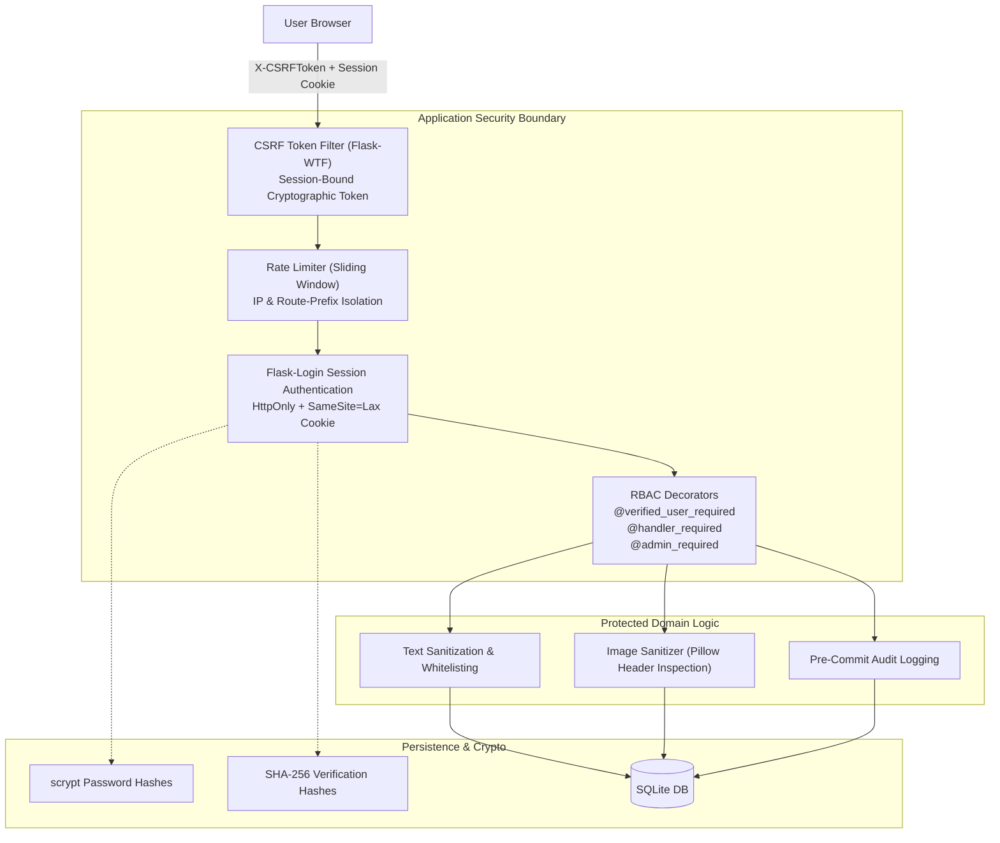

# CampusVoice: Security Architecture & Deployment Evaluation

This document provides a thorough audit of the security posture, authentication lifecycle, privacy guarantees, and deployment readiness of the CampusVoice platform.

---

## 1. Security Architecture & Threat Modeling



---

## 2. Authentication, Session & Token Lifecycle

### 1. Password Storage & Hashing
- **Algorithm**: Standard Werkzeug scrypt hashing format (`scrypt:32768:8:1:<salt>:<hash>`).
- **Enforcement**: Passwords must contain a minimum of 8 characters and include uppercase, lowercase, numbers, and special characters ([`app/services/security.py#L32-L50`](file:///c:/Users/Rohit/Digital_campus/Digital_campus/app/services/security.py#L32-L50)).
- **Normalization**: User emails are uniformly lowercased and stripped of leading/trailing whitespace prior to database lookup and registration to prevent duplicate accounts via capitalization variance.

### 2. Email Verification Token Security
- **Generation**: High-entropy cryptographically secure random token generated via `secrets.token_urlsafe(32)` ([`app/services/email.py#L23`](file:///c:/Users/Rohit/Digital_campus/Digital_campus/app/services/email.py#L23)).
- **Storage**: Raw tokens are **never stored in the database**. The database records only a SHA-256 digest (`hashlib.sha256(raw_token.encode("utf-8")).hexdigest()`) in [`app/models/user.py#L98`](file:///c:/Users/Rohit/Digital_campus/Digital_campus/app/models/user.py#L98). Even a complete database compromise will not allow an attacker to forge or reuse verification tokens.
- **Expiration & Single-Use**: Tokens expire after 24 hours (`expires_at`). Once redeemed, the record is timestamped (`used_at = now()`) and invalidated immediately.
- **Leakage Prevention**: Public API endpoints (`/api/auth/register`, `/api/auth/resend-verification`) never return verification tokens in the response JSON.

### 3. CSRF Protection Architecture
- **Mechanism**: Flask-WTF CSRF validation is active across all state-mutating requests (`POST`, `PUT`, `DELETE`).
- **Token Delivery**: Clients retrieve a fresh token bound to their active session via `GET /api/auth/csrf` or `GET /api/auth/csrf-token`.
- **Cache-Control Headers**: The CSRF endpoint explicitly injects:
  ```http
  Cache-Control: no-store, no-cache, must-revalidate, max-age=0
  Pragma: no-cache
  Expires: 0
  ```
  This prevents reverse proxies or service workers from serving cached tokens.
- **Request Header**: The Axios client automatically injects the token in the `X-CSRFToken` HTTP header on every mutating request.

### 4. Cookie Configuration
- `SESSION_COOKIE_HTTPONLY = True`: Blocks JavaScript access (`document.cookie`), mitigating session-hijacking via Cross-Site Scripting (XSS).
- `SESSION_COOKIE_SAMESITE = "Lax"`: Restricts cross-site request forgery while permitting top-level navigation.
- `SESSION_COOKIE_SECURE`: Dynamically set to `True` when running under HTTPS or on Render (`os.environ.get("RENDER")`), ensuring cookies are only transmitted over TLS in production.

---

## 3. Privacy, IDOR & Access Control Review

### 1. Insecure Direct Object References (IDOR) Defenses
- **Complaint View**: [`/api/complaints/<id>`](file:///c:/Users/Rohit/Digital_campus/Digital_campus/app/blueprints/api/complaints.py#L182) validates that `complaint.user_id == current_user.id` or `current_user.is_handler`. Non-owners receive HTTP 403.
- **Attachment Download**: [`/api/complaints/attachment/<filename>`](file:///c:/Users/Rohit/Digital_campus/Digital_campus/app/blueprints/api/complaints.py#L286) resolves the associated complaint and validates ownership or handler privileges before calling `send_from_directory()`. Filenames are sanitized via `secure_filename()` to prevent directory traversal attacks (`../../etc/passwd`).
- **Resolution Feedback**: [`/api/feedback/issue/<id>`](file:///c:/Users/Rohit/Digital_campus/Digital_campus/app/blueprints/api/feedback.py#L30) validates that the current user submitted at least one complaint linked to the target issue. External users are denied with HTTP 403.

### 2. Submitter Privacy in Triage & Public Boards
- **Triage Queue**: In [`app/blueprints/api/admin.py#L71`](file:///c:/Users/Rohit/Digital_campus/Digital_campus/app/blueprints/api/admin.py#L71), student names and email addresses are omitted from the returned JSON. Handlers triage submissions using `"Anonymous Submitter #<user_id>"`.
- **Public Issues**: In [`app/blueprints/api/issues.py#L40`](file:///c:/Users/Rohit/Digital_campus/Digital_campus/app/blueprints/api/issues.py#L40), the public transparency endpoint returns only the synthesized issue title, category, building, priority, status, and the count of linked complaints. Raw student descriptions and submitter IDs are never exposed.

### 3. Audited Identity Unmasking
- **Access Level**: Only administrators (`@admin_required`) can unmask a submitter. Campus facility handlers receive HTTP 403.
- **Pre-Commit Contract**: In [`app/services/audit.py#L30-L45`](file:///c:/Users/Rohit/Digital_campus/Digital_campus/app/services/audit.py#L30-L45), the required operational justification (minimum 5 characters) is validated and written to an immutable `AuditEvent` table. If the database commit fails, the transaction is rolled back and identity information is **never returned**.

---

## 4. Cloud Deployment Audit (Render Environment)

Inspection of [`render.yaml`](file:///c:/Users/Rohit/Digital_campus/Digital_campus/render.yaml) and runtime configuration:

```yaml
services:
  - type: web
    name: campusvoice
    runtime: python
    plan: free
    buildCommand: pip install -r requirements.txt && python -m flask campus_cli warmup-model
    startCommand: python run.py
    envVars:
      - key: HOST
        value: 0.0.0.0
      - key: PYTHON_VERSION
        value: 3.11.10
      - key: HF_HOME
        value: /opt/render/project/src/.cache/huggingface
      - key: ALLOW_MODEL_DOWNLOAD
        value: "true"
      - key: EMAIL_PROVIDER
        value: resend
      - key: RESEND_API_KEY
        sync: false
      - key: BOOTSTRAP_DEMO_DATA
        value: "true"
```

### Critical Deployment Findings

#### Finding 1: Frontend Build Missing from Build Command (P0)
- **Current `buildCommand`**: `pip install -r requirements.txt && python -m flask campus_cli warmup-model`
- **Issue**: Vite frontend compilation (`npm run build`) is not executed during deployment. If pre-built static assets in `frontend/dist/` are not committed to git, Render serves a 404 or missing asset error.
- **Required Action**: Change build command to:
  ```bash
  npm install --prefix frontend && npm run build --prefix frontend && pip install -r requirements.txt && python -m flask campus_cli warmup-model
  ```

#### Finding 2: `SECRET_KEY` Persistence on Ephemeral Containers (P0)
- **Mechanism**: In `app/config.py`, `_resolve_secret_key()` checks `os.environ.get("SECRET_KEY")`. If missing, it writes a random key to `.secret_key` on disk.
- **Issue**: On Render Free Tier, the container filesystem is ephemeral and recreated on every deployment or spin-down cycle. If `SECRET_KEY` is not explicitly set in the Render Dashboard environment variables, every restart changes the key, instantly invalidating all active user sessions and CSRF tokens.
- **Required Action**: Generate a persistent 32-byte hex secret and add `SECRET_KEY` to Render Environment Variables.

#### Finding 3: Outbound SMTP Blocking on Free Tier (P0)
- **Condition**: Cloud providers (including Render and AWS EC2 free tiers) block outbound traffic on port 25 and throttle ports 465/587 to prevent spam.
- **Status in Codebase**: CampusVoice already implements HTTPS REST adapters for **Resend** (`_send_via_resend`) and **SendGrid** (`_send_via_sendgrid`).
- **Required Action**: Ensure `EMAIL_PROVIDER=resend` and enter a valid `RESEND_API_KEY` in Render dashboard.

#### Finding 4: Ephemeral SQLite Persistence Risk (P1)
- **Condition**: The default database path is `campusvoice.db` stored in the project root.
- **Issue**: Any updates, complaints, or user registrations created on Render will be wiped whenever Render restarts the container (due to inactivity or redeploys).
- **Required Action for Production**: For long-term production, attach a Render Persistent Disk (available on paid plans) or connect to an external PostgreSQL database (e.g. Neon, Supabase, Render Postgres) by configuring `DATABASE_URL`.

